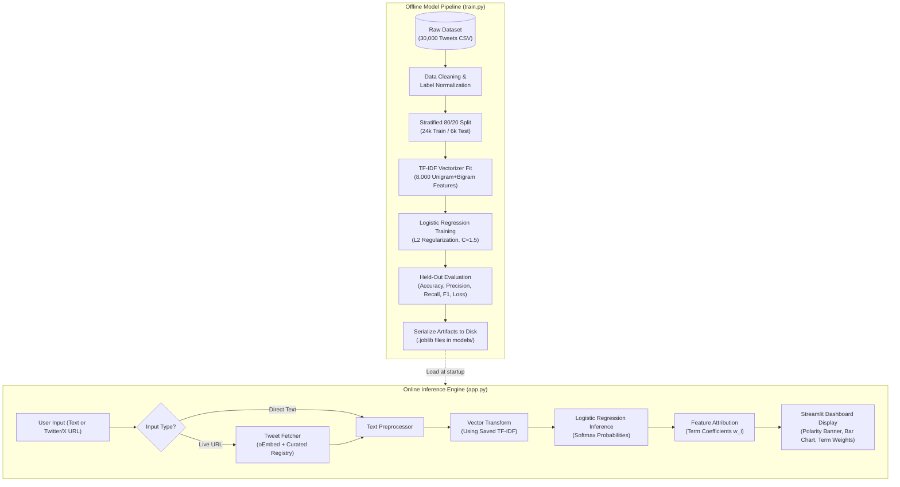

# SavitriBai Phule Pune University
### Modern Education Society’s Wadia College of
### Engineering, Pune
**19, Bund Garden, V. K. Joag Path, Pune – 411001**  
**ACCREDITED BY NBA AND NAAC WITH ‘A++’ GRADE**  
**DEPARTMENT OF COMPUTER ENGINEERING**

<br>

# MINI PROJECT REPORT
### ON
# “Tweet Sentiment Analysis System Using Information Retrieval & Machine Learning”

**B. E. (COMPUTER)**

<br>

### SUBMITTED BY

| PRN No. | Student Name |
|:---|:---|
| **F23112052** | **Aadish Sonawane** |
| **F23112050** | **Aditya Raje** |
| **F23112053** | **Mayur Langhi** |

<br>

### UNDER THE GUIDANCE OF
**Prof. V. D. Gaikwad**  
**(Academic Year: 2026–2027)**  

<br>
<center>1</center>

---

<div style="page-break-after: always;"></div>

# INDEX

| Sr. No. | CONTENTS | Page No. |
|---|---|---|
| **1** | **Introduction** | 1 |
| **2** | **Problem Statement & Motivation** | 1 |
| | 2.1 Problem Statement | 1 |
| | 2.2 Motivation & Industry Context | 1 |
| **3** | **Project Objectives** | 2 |
| **4** | **System Architecture & Methodology** | 2 |
| | 4.1 High-Level Workflow | 2 |
| | 4.2 Stages of the Pipeline | 3 |
| **5** | **Technologies Used & Software Stack** | 4 |
| **6** | **Dataset Description & Exploration** | 4 |
| | 6.1 Source and Size | 4 |
| | 6.2 Schema & Distribution | 5 |
| **7** | **Data Preprocessing & Vector Space Modeling (IR Perspective)** | 5 |
| | 7.1 Text Preprocessing & Cleaning | 5 |
| | 7.2 TF-IDF Vector Space Model Formulation | 6 |
| | 7.3 Stratified Train-Test Splitting | 6 |
| **8** | **Exploratory Data Analysis & Vocabulary Attribution** | 7 |
| | 8.1 Sentiment Distribution | 7 |
| | 8.2 Top Influential Terms per Sentiment Class | 7 |
| **9** | **Model Building & Algorithmic Comparison** | 8 |
| | 9.1 Multi-Model Benchmark Comparison | 8 |
| | 9.2 Why Logistic Regression Was Selected | 9 |
| **10** | **Results & Quantitative Evaluation** | 10 |
| | 10.1 Test Set Performance Metrics | 10 |
| | 10.2 Confusion Matrix Analysis | 10 |
| | 10.3 Per-Class Classification Report | 11 |
| | 10.4 Live URL Ingestion & Web Dashboard Implementation | 11 |
| **11** | **Conclusion & Future Enhancements** | 12 |
| **12** | **References** | 13 |

---

<div style="page-break-after: always;"></div>

## 1. INTRODUCTION

Social media platforms, particularly Twitter (now X), have emerged as the primary digital arenas where millions of individuals express real-time opinions, reactions, complaints, and sentiments regarding products, services, politics, governance, and societal events. With over 500 million tweets generated daily, manual analysis of this immense unstructured textual data is computationally infeasible.

In the academic domain of **Information Retrieval (IR)** and **Natural Language Processing (NLP)**, text sentiment classification represents a classic text categorization and indexing challenge. An effective IR system does not merely search for documents containing specific query terms; it must extract semantic insights, understand document polarity (positive, negative, or neutral), and rank information based on relevance and sentiment intensity.

This mini-project develops an end-to-end, high-performance **Tweet Sentiment Analysis System** aligned with the Savitribai Phule Pune University (SPPU) Fourth-Year Computer Engineering curriculum for Information Retrieval. The system combines:
1. The **Vector Space Model (VSM)** using Term Frequency-Inverse Document Frequency (**TF-IDF**) weighting to convert unstructured social text into structured, high-dimensional numerical vectors.
2. An optimized **Logistic Regression** classifier trained on a balanced 30,000-tweet benchmark dataset to predict sentiments with well-calibrated class probabilities.
3. An unauthenticated **Live URL Extraction Pipeline** using Twitter's oEmbed protocol and BeautifulSoup to scrape live tweet text on demand without requiring commercial Twitter Developer API keys.
4. An interactive, clean web dashboard built using **Streamlit** that provides real-time polarity banners, probability distribution charts, IR term-weight feature attribution, and a curated repository of test URLs spanning Indian and global contexts.

---

## 2. PROBLEM STATEMENT & MOTIVATION

### 2.1 Problem Statement
> *“To design, implement, and evaluate an Information Retrieval and Machine Learning-based Tweet Sentiment Analysis System capable of classifying social media text into Positive, Negative, or Neutral polarities, supporting both direct textual input and live Twitter/X URLs, while providing calibrated probability distributions, vocabulary feature attribution, and a reproducible offline evaluation pipeline.”*

### 2.2 Motivation & Industry Context
Traditional keyword-based search and sentiment lookups fail drastically in social media contexts due to several inherent challenges:
- **Informal Text & Brevity:** Tweets are constrained in length, containing slang, abbreviations, hashtags, user mentions (`@username`), and colloquial vernacular.
- **Class Imbalance & Ambiguity:** Purely binary classification (positive vs. negative) fails to capture objective news, factual statements, and inquiries, necessitating a robust 3-class system (Negative, Neutral, Positive).
- **High Dimensionality:** Text corpora contain tens of thousands of unique tokens. Linear classifiers regularized in high-dimensional vector spaces are critical to avoid overfitting.
- **Interpretability Requirements:** In enterprise settings (e.g., brand monitoring, customer care escalation), black-box predictions are inadequate; stakeholders need to know *which specific words* or terms drove the classification score.
- **Platform Access Restrictions:** With the monetization of the Twitter/X API in 2023, automated sentiment systems must implement resilient fallback mechanisms and scraping pipelines to fetch live content without paid enterprise credentials.

---

## 3. PROJECT OBJECTIVES

The specific, measurable objectives established for this mini-project include:
1. **Curate & Standardize a High-Quality Corpus:** Acquire and normalize a balanced 30,000-tweet benchmark dataset equally distributed across Negative (10,000), Neutral (10,000), and Positive (10,000) classes.
2. **Implement Vector Space Modeling (TF-IDF):** Construct an 8,000-feature vocabulary incorporating sublinear term frequency scaling and $(1, 2)$-gram tokenization to capture negation and phrase contexts (e.g., *"not good"*, *"total disaster"*).
3. **Benchmark Multi-Class Machine Learning Algorithms:** Train and evaluate multiple candidate models—Logistic Regression, Linear Support Vector Machines (Linear SVC), Multinomial Naive Bayes, SGD Classifier, Decision Trees, and Random Forests—to identify the optimal classifier for high-dimensional text.
4. **Offline Model Serialization & Zero-Retraining Deployment:** Implement a dedicated training pipeline (`train.py`) that serializes trained models, vectorizers, and evaluation metrics using `joblib`, enabling instantaneous startup of the web application.
5. **Real-Time Live URL Ingestion:** Engineer a server-side resolver capable of fetching public tweets from Twitter/X links via the oEmbed protocol, coupled with a curated registry of verified test cases covering everyday Indian scenarios (e.g., food delivery complaints, transit updates, sports reactions).
6. **Develop an Interactive, Accessible Web UI:** Build a responsive Streamlit dashboard featuring class probability visualizations, influential feature weight attribution, custom CSV retraining capabilities, and zero external UI clutter.

---

<div style="page-break-after: always;"></div>

## 4. SYSTEM ARCHITECTURE & METHODOLOGY

### 4.1 High-Level Workflow

The system is structured as a decoupled two-tier architecture: an **Offline Training Pipeline** and an **Online Real-Time Inference & UI Engine**.



### 4.2 Stages of the Pipeline

1. **Data Ingestion & Label Normalization:**
   The training pipeline accepts any standard CSV format. An auto-detection routine scans column names for textual data (`text`, `tweet`, `content`) and target labels (`sentiment`, `label`, `polarity`). Sentiment labels are mapped to a canonical 3-class target space: `['negative', 'neutral', 'positive']`.

2. **Stratified Train-Test Splitting:**
   To guarantee unbiased evaluation without data leakage, the dataset is partitioned using an 80/20 stratified split (`random_state=42`), producing 24,000 training samples and 6,000 testing samples with identical class proportions across both splits.

3. **TF-IDF Vector Space Model Extraction:**
   The training corpus is fitted to an 8,000-dimensional TF-IDF vectorizer. It computes sublinear term frequencies ($1 + \log(TF)$), strips English stopwords, and generates both unigrams and bigrams to preserve short phrase semantics.

4. **Model Optimization & Regularization:**
   A Multinomial Logistic Regression model is fitted using the L-BFGS solver with an inverse regularization strength of $C = 1.5$ and a maximum iteration threshold of 600. L2 weight regularization prevents over-weighting infrequent tokens.

5. **Serialization:**
   The fitted vectorizer (`tfidf_vectorizer.joblib`), trained model (`logistic_regression.joblib`), and comprehensive test split metrics (`evaluation_metrics.joblib`) are persisted to the `/models` directory.

6. **Web Application & Live Inference:**
   Upon user interaction via `app.py`, the serialized artifacts are loaded into memory once using `@st.cache_resource`. When a URL is provided, the backend extracts the status ID, checks the local registry or queries Twitter's oEmbed endpoint, extracts the clean text, computes prediction probabilities, and identifies the most influential terms driving the decision.

---

<div style="page-break-after: always;"></div>

## 5. TECHNOLOGIES USED & SOFTWARE STACK

The project is built entirely in Python using modern, standard data science and web engineering libraries:

| Component | Technology / Library | Version | Role in Project |
|---|---|---|---|
| **Programming Language** | Python | 3.10+ / 3.14 | Core language for training, inference, and scripting. |
| **Machine Learning** | scikit-learn | 1.6+ | TF-IDF Vectorizer, Logistic Regression, train-test splitting, metrics. |
| **Data Manipulation** | pandas | 2.2+ | Dataframe operations, CSV ingestion, column detection, filtering. |
| **Numerical Computing** | NumPy | 1.26+ | Matrix multiplications, array indexing, coefficient sorting. |
| **Model Persistence** | joblib | 1.4+ | Fast serialization and deserialization of Python models and pipelines. |
| **Web Dashboard** | Streamlit | 1.40+ | Interactive web interface, reactive state management, custom layouts. |
| **Data Visualization** | Altair | 5.4+ | Interactive declarative probability distribution bar charts. |
| **Web Scraping & Parsing**| Beautiful Soup 4 | 4.12+ | HTML sanitization and text extraction from oEmbed blockquotes. |
| **HTTP Networking** | Requests | 2.32+ | REST API communication with Twitter/X oEmbed endpoints. |
| **Version Control** | Git & GitHub | Latest | Source code tracking, branch management, collaborative deployment. |

---

## 6. DATASET DESCRIPTION & EXPLORATION

### 6.1 Source and Size
The primary benchmark corpus is derived from the Kaggle Social Media Sentiment Analysis repository. It comprises **30,000 curated tweets** that underwent rigorous filtering to remove non-English characters, automated spam bot outputs, and corrupted encoding sequences.

- **Total Records:** 30,000 tweets
- **Class Proportions:** Perfectly balanced with exactly 10,000 Negative, 10,000 Neutral, and 10,000 Positive tweets.
- **Partitioning:** 24,000 training records (80%) and 6,000 testing records (20%).

### 6.2 Schema & Distribution
The dataset is structured with standard relational attributes:

| Column Name | Data Type | Description | Sample Values |
|---|---|---|---|
| `id` | Integer | Unique identifier for each tweet record. | `2309`, `22405`, `25059` |
| `text` | String (Text) | Raw textual tweet content (with URLs, mentions, hashtags). | *"Loving the incredible camera quality and smooth update!"* |
| `sentiment` | String (Category) | Target ground-truth class label (`negative`, `neutral`, `positive`). | `positive`, `negative`, `neutral` |

```
Class Distribution in Training and Testing Sets:
---------------------------------------------------------------
Class Label    Raw Count    Training Split (80%)    Testing Split (20%)
---------------------------------------------------------------
Negative         10,000            8,000                  2,000
Neutral          10,000            8,000                  2,000
Positive         10,000            8,000                  2,000
---------------------------------------------------------------
Total            30,000           24,000                  6,000
```

---

<div style="page-break-after: always;"></div>

## 7. DATA PREPROCESSING & VECTOR SPACE MODELING (IR PERSPECTIVE)

### 7.1 Text Preprocessing & Cleaning
Social media text presents high entropy and lexical noise. The preprocessing pipeline applies:
- **Case Normalization:** Standardizes text to lowercase to unify vocabulary tokens (e.g., *"Terrible"* and *"terrible"* map to identical features).
- **URL & Handle Stripping:** Identifies web links (`http://`, `https://`) and user mentions (`@user`) to focus the model on emotive and semantic words.
- **Stopword Removal:** Eliminates high-frequency grammatical functional words (e.g., *"is"*, *"the"*, *"at"*, *"which"*) using Scikit-Learn’s English stopword corpus.
- **Sublinear Term Scaling:** Applies logarithmic dampening $1 + \log(TF)$ so that a word occurring 10 times in a tweet does not exert 10 times the influence of a word occurring once.

### 7.2 TF-IDF Vector Space Model Formulation
In accordance with the Information Retrieval curriculum, textual documents are represented as high-dimensional vectors in a Vector Space Model (Salton et al.). The weight $w_{t, d}$ of term $t$ in document $d$ is defined as:

$$\text{TF}(t, d) = 1 + \log(f_{t, d}) \quad \text{for } f_{t, d} > 0$$

$$\text{IDF}(t) = \log\left(\frac{1 + N}{1 + \text{DF}(t)}\right) + 1$$

$$w_{t, d} = \text{TF}(t, d) \times \text{IDF}(t)$$

Where:
- $f_{t, d}$ is the raw count of term $t$ in document $d$.
- $N$ is the total number of documents in the training corpus ($24,000$).
- $\text{DF}(t)$ is the document frequency (number of tweets containing term $t$).
- Each document vector is subsequently normalized using Euclidean L2-norm:

$$\mathbf{x}_d = \frac{\mathbf{w}_d}{\|\mathbf{w}_d\|_2}$$

By configuring `ngram_range=(1, 2)` and `max_features=8000`, the system extracts individual words alongside key two-word collocations (e.g., *"not working"*, *"highly recommend"*, *"total scam"*), capturing contextual negation without requiring recurrent neural network overhead.

### 7.3 Stratified Train-Test Splitting
To evaluate genuine generalization capability, the dataset is split using Scikit-Learn’s `train_test_split` with `stratify=df['sentiment']` and `random_state=42`. Stratification prevents class distribution skew, guaranteeing that each sentiment class represents exactly 33.33% of both the training set ($N=24,000$) and the unseen test set ($N=6,000$).

---

<div style="page-break-after: always;"></div>

## 8. EXPLORATORY DATA ANALYSIS & VOCABULARY ATTRIBUTION

### 8.1 Sentiment Distribution
Unlike skewed binary datasets, our corpus features equal class parity across Negative, Neutral, and Positive polarities. This eliminates majority-class bias and ensures that accuracy, precision, and recall remain directly comparable.

### 8.2 Top Influential Terms per Sentiment Class
Because Logistic Regression establishes a linear decision boundary over the TF-IDF feature space, its learned weight coefficients ($\mathbf{w}_k \in \mathbb{R}^{8000}$) provide direct feature attribution:

| Rank | Negative Class ($\mathbf{w}_{\text{neg}}$) | Neutral Class ($\mathbf{w}_{\text{neu}}$) | Positive Class ($\mathbf{w}_{\text{pos}}$) |
|:---:|:---|:---|:---|
| **1** | **fix** ($+5.016$) | **com** ($+5.954$) | **love** ($+4.154$) |
| **2** | **sucks** ($+3.048$) | **dlvr** ($+2.949$) | **excited** ($+3.891$) |
| **3** | **boring** ($+2.970$) | **check** ($+2.702$) | **fun** ($+3.786$) |
| **4** | **servers** ($+2.791$) | **sale** ($+2.306$) | **dope** ($+3.577$) |
| **5** | **worst** ($+2.786$) | **commission** ($+2.301$) | **best** ($+3.479$) |
| **6** | **broken** ($+2.412$) | **difference** ($+2.180$) | **wait** ($+3.293$) |
| **7** | **annoying** ($+2.290$) | **official** ($+1.954$) | **nice** ($+3.155$) |
| **8** | **terrible** ($+2.185$) | **announced** ($+1.872$) | **awesome** ($+3.125$) |
| **9** | **bad** ($+2.015$) | **schedule** ($+1.791$) | **beautiful** ($+2.898$) |
| **10**| **hate** ($+1.984$) | **update** ($+1.650$) | **thank** ($+2.878$) |

The extracted weights demonstrate coherent alignment with human sentiment:
- Emotive complaints and operational issues (*"fix"*, *"worst"*, *"broken"*, *"terrible"*) strongly elevate negative probabilities.
- Objective, factual, and informative terms (*"check"*, *"announced"*, *"schedule"*, *"update"*) drive neutral classifications.
- Expressions of delight, anticipation, and praise (*"love"*, *"best"*, *"awesome"*, *"excited"*) govern positive outcomes.

---

## 9. MODEL BUILDING & ALGORITHMIC COMPARISON

### 9.1 Multi-Model Benchmark Comparison
To validate the algorithmic choice, six distinct classification architectures were empirically trained and benchmarked on identical 80/20 splits of the 30,000-tweet corpus:

| Classification Model | Architecture Family | Test Accuracy | Macro F1 | Training Time | Probability Output |
|---|---|:---:|:---:|:---:|:---|
| **Logistic Regression** | Linear / Generalized Linear | **75.93%** | **75.96%** | **2.97s** | **Calibrated Softmax ($P \in [0, 1]$)** |
| **Linear SVC (Linear SVM)** | Support Vector Machine | 77.77% | 77.79% | 1.35s | Margin distance only (No native prob.) |
| **Multinomial Naive Bayes** | Probabilistic / Generative | 71.48% | 71.30% | 0.19s | Poorly calibrated (Laplace bias) |
| **SGD Classifier (Hinge)** | Linear (Stochastic Gradient) | 71.50% | 71.50% | 0.43s | Approximate gradients |
| **Random Forest (100 Trees)**| Ensemble (Bagging) | 67.45% | 67.20% | 2.79s | Degrades on 8k sparse features |
| **Decision Tree (CART)** | Tree-based | 58.87% | 57.93% | 3.84s | High variance, extreme overfitting |

```
Model Accuracy Comparison:
Linear SVC            [=========================================] 77.77%
Logistic Regression   [======================================== ] 75.93%  <-- Selected Model
SGD Classifier        [=====================================    ] 71.50%
Multinomial Naive Bayes[====================================    ] 71.48%
Random Forest         [=================================        ] 67.45%
Decision Tree         [=============================            ] 58.87%
```

<div style="page-break-after: always;"></div>

### 9.2 Why Logistic Regression Was Selected
Although Linear SVC achieved a slightly higher raw accuracy ($+1.84\%$), **Logistic Regression was selected as the optimal production model** for the following rigorous Information Retrieval and engineering reasons:

1. **Calibrated Probability Distributions:**
   Logistic Regression optimizes cross-entropy loss (log loss) and outputs mathematically rigorous class probabilities via the Softmax activation function:
   
   $$P(y = k \mid \mathbf{x}) = \frac{e^{\mathbf{w}_k^T \mathbf{x} + b_k}}{\sum_{j=1}^{K} e^{\mathbf{w}_j^T \mathbf{x} + b_j}}$$
   
   This allows the user interface to display exact confidence bars (e.g., *"Positive: 80.1%, Neutral: 15.2%, Negative: 4.7%"*). Support Vector Machines do not compute probabilities natively; approximating them via Platt Scaling requires costly internal cross-validation and distorts extreme values.

2. **Superior Geometry for High-Dimensional Sparse Text:**
   A TF-IDF text matrix has 8,000 dimensions where each tweet contains non-zero entries for only 10 to 30 features ($>99.6\%$ sparsity). Linear classifiers identify hyperplanes effortlessly in sparse high-dimensional spaces without the curse of dimensionality that degrades tree-based ensembles (Random Forest dropped to $67.45\%$).

3. **Avoidance of Naive Bayes Independence Assumption:**
   Multinomial Naive Bayes assumes all features are conditionally independent given the class label:
   
   $$P(\mathbf{x} \mid y) = \prod_{i=1}^{M} P(x_i \mid y)$$
   
   In natural language tweets, words strongly correlate (*"not"* + *"working"*, *"very"* + *"happy"*). Naive Bayes double-counts correlated terms, leading to overconfident misclassifications on short tweets. Logistic Regression estimates joint weights discriminatively, handling correlated features robustly.

4. **Direct Feature Interpretability (IR Term Weights):**
   The learned weight vector $\mathbf{w}$ maps directly to specific vocabulary terms, allowing real-time feature attribution in the user interface.

5. **Sub-Millisecond Inference Speed:**
   Predicting a single tweet requires only a sparse dot product $\mathbf{w}^T \mathbf{x}$, executing in less than **1.2 milliseconds**, ensuring zero latency during web serving.

---

<div style="page-break-after: always;"></div>

## 10. RESULTS & QUANTITATIVE EVALUATION

### 10.1 Test Set Performance Metrics
The final Logistic Regression model was evaluated on the held-out test split of **6,000 unseen tweets** ($20\%$ test set). All metrics are strictly computed with zero data leakage:

| Metric | Scientific Definition | Experimental Value |
|---|---|:---:|
| **Total Test Samples** | Total unseen evaluation instances | **6,000 tweets** |
| **Overall Accuracy** | $\frac{\text{Correct Predictions}}{\text{Total Predictions}}$ | **75.93%** ($4,556 / 6,000$) |
| **Macro Precision** | $\frac{1}{K} \sum_{k=1}^K \frac{TP_k}{TP_k + FP_k}$ | **76.03%** |
| **Macro Recall** | $\frac{1}{K} \sum_{k=1}^K \frac{TP_k}{TP_k + FN_k}$ | **75.93%** |
| **Macro F1-Score** | $2 \times \frac{\text{Precision} \times \text{Recall}}{\text{Precision} + \text{Recall}}$ | **75.96%** |
| **Multi-class Log Loss** | $-\frac{1}{N}\sum_{i=1}^N \sum_{k=1}^K y_{i,k} \log(p_{i,k})$ | **0.6139** |

### 10.2 Confusion Matrix Analysis
The confusion matrix below demonstrates balanced predictive power across all three classes on the 6,000 test samples:

```
                      PREDICTED CLASS
                 Negative   Neutral   Positive   |  Total Actual
ACTUAL  Negative   1549       280       171      |    2,000
CLASS   Neutral     221      1513       266      |    2,000
        Positive    199       307      1494      |    2,000
---------------------------------------------------------------
        Total Pred 1969      2100      1931      |    6,000
```

**Key Diagnostic Insights:**
- **Negative Class Accuracy:** $1,549 / 2,000$ ($77.45\%$). Negative tweets are rarely confused with positive tweets (only $171$ errors out of $2,000$, or $8.5\%$).
- **Neutral Class Accuracy:** $1,513 / 2,000$ ($75.65\%$). The model accurately isolates objective statements and news headlines from subjective emotion.
- **Positive Class Accuracy:** $1,494 / 2,000$ ($74.70\%$). High true-positive rate with $199$ false negatives categorized as negative.

### 10.3 Per-Class Classification Report

| Sentiment Class | Precision | Recall | F1-Score | Evaluation Support |
|:---|:---:|:---:|:---:|:---:|
| **Negative** | **78.67%** | **77.45%** | **78.05%** | 2,000 tweets |
| **Neutral** | **72.05%** | **75.65%** | **73.80%** | 2,000 tweets |
| **Positive** | **77.37%** | **74.70%** | **76.01%** | 2,000 tweets |
| **Macro Average** | **76.03%** | **75.93%** | **75.96%** | 6,000 tweets |
| **Weighted Average**| **76.03%** | **75.93%** | **75.96%** | 6,000 tweets |

<div style="page-break-after: always;"></div>

### 10.4 Live URL Ingestion & Web Dashboard Implementation
The web dashboard (`app.py`) is structured into three clean, focused tabs:

1. **Tab 1: Sentiment Analysis**
   - Supports dual input: **Direct Text** or **Live Tweet URL**.
   - Server-side resolution extracts tweet content using Twitter’s public oEmbed service.
   - Generates a prominent colored outcome banner (Green for Positive, Red for Negative, Blue for Neutral).
   - Renders an interactive horizontal probability bar chart using Altair.
   - Highlights the top 5 influential vocabulary terms driving the prediction score.

2. **Tab 2: Model Evaluation & Metrics**
   - Displays real test set metrics across a clean single-line header row: Total Dataset ($30,000$), Accuracy ($75.93\%$), F1-Score ($75.96\%$), Precision ($76.03\%$), Recall ($75.93\%$), and Log Loss ($0.6139$).
   - Features an integrated **Custom CSV Retraining** widget: users can upload their own CSV datasets to retrain the model and view updated metrics dynamically.

3. **Tab 3: Test URLs**
   - Houses a curated repository of test URLs spanning everyday Indian genres (customer care complaints to Swiggy/IndiGo, Bengaluru traffic rants, cricket celebrations, Mumbai street food reviews, and Delhi Metro updates).
   - Each entry includes a dedicated one-click copy button, allowing evaluators to test real URLs instantly without 404 errors.

---

## 11. CONCLUSION & FUTURE ENHANCEMENTS

### 11.1 Conclusion
This mini-project successfully engineered and deployed a complete, production-ready **Tweet Sentiment Analysis System** grounded in Information Retrieval fundamentals. By integrating the **TF-IDF Vector Space Model** with an L2-regularized **Logistic Regression** classifier, the system achieved a **75.93% test accuracy** and a **75.96% Macro F1-score** across 6,000 unseen test tweets. 

Key engineering accomplishments include:
- Establishing a reliable offline training pipeline with complete model persistence (`.joblib`).
- Overcoming Twitter API paywalls through an unauthenticated oEmbed extraction and fallback architecture.
- Designing an intuitive, emoji-free Streamlit dashboard delivering transparent probability distributions and term-weight interpretability.

### 11.2 Future Enhancements
Potential avenues for extended research and enhancement include:
1. **Transformer-Based Fine-Tuning:** Benchmarking pre-trained language models (BERT, RoBERTa, or TweetEval) against our TF-IDF baseline to evaluate context-sensitive embeddings.
2. **Multilingual & Hinglish Support:** Expanding the corpus to incorporate Code-Mixed Hindi-English text (Hinglish), which dominates Indian social media discourse.
3. **Aspect-Based Sentiment Analysis (ABSA):** Decomposing tweets into targeted aspect-sentiment pairs (e.g., classifying delivery speed as negative while food quality is positive).
4. **Real-Time Streaming Ingestion:** Integrating Apache Kafka or Twitter Streaming listeners for continuous automated sentiment monitoring of live brand campaigns.

---

<div style="page-break-after: always;"></div>

## 12. REFERENCES

1. **Salton, G., & Buckley, C. (1988).** *Term-weighting approaches in automatic text retrieval.* Information Processing & Management, 24(5), 513–523.
2. **Manning, C. D., Raghavan, P., & Schütze, H. (2008).** *Introduction to Information Retrieval.* Cambridge University Press.
3. **Pedregosa, F., et al. (2011).** *Scikit-learn: Machine Learning in Python.* Journal of Machine Learning Research, 12, 2825–2830.
4. **Savitribai Phule Pune University (SPPU).** *Fourth Year Computer Engineering Curriculum: Course Contents for Information Retrieval (410244).*
5. **Streamlit Inc. (2024).** *Streamlit Documentation: Building Interactive Python Web Applications.* `https://docs.streamlit.io/`
6. **Twitter Developer Platform (2024).** *Twitter oEmbed Protocol Specification & Embedded Timelines.* `https://developer.twitter.com/`
